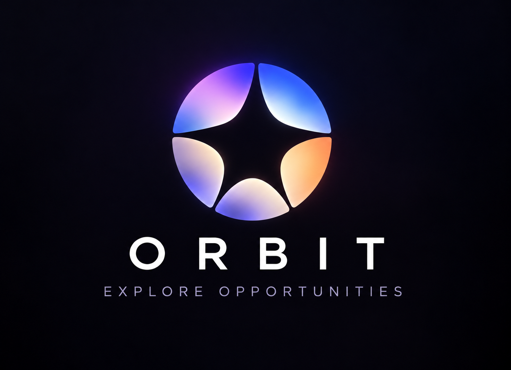
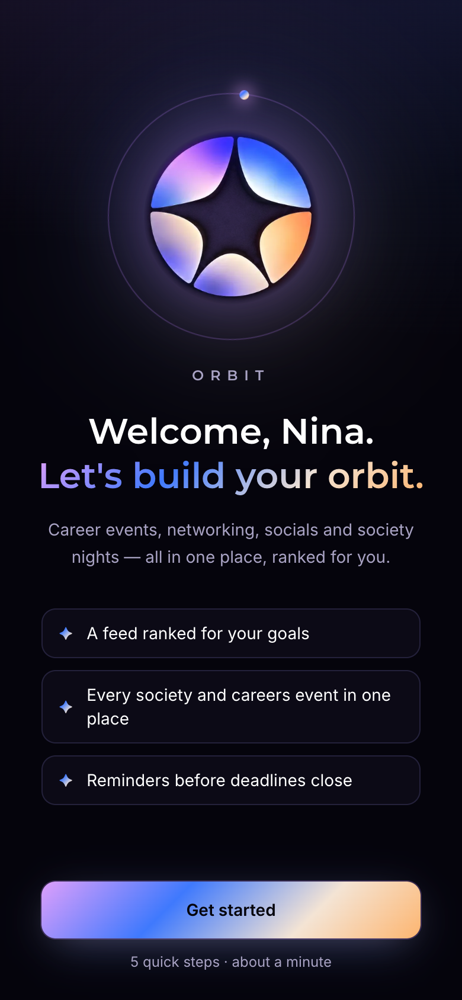
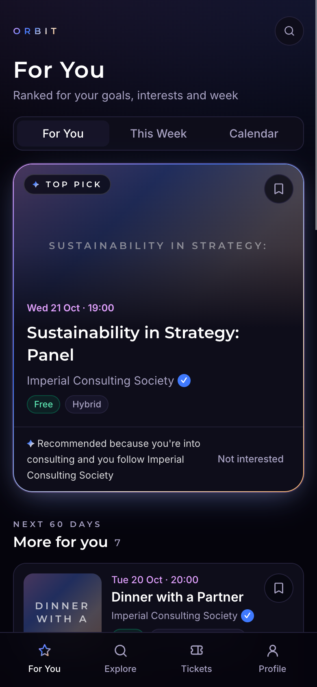
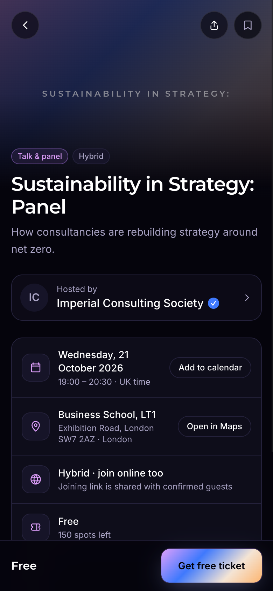
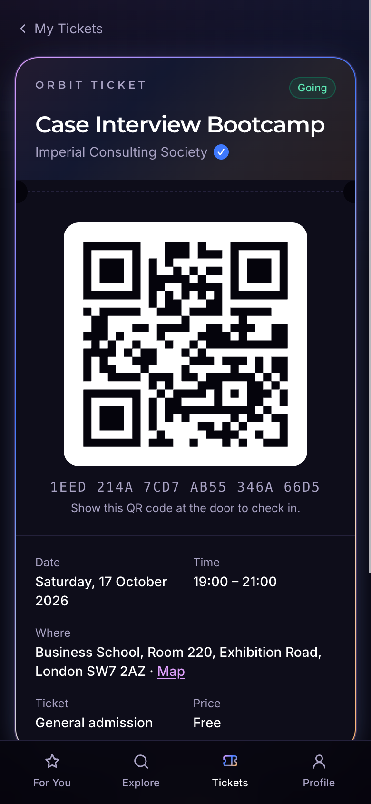
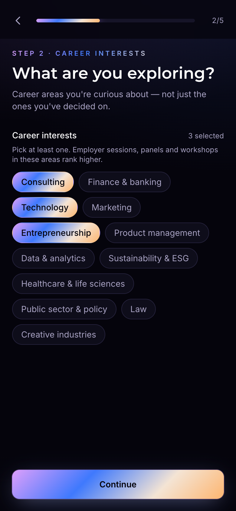
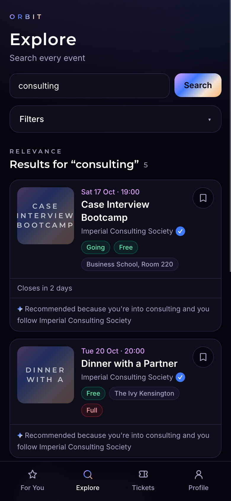
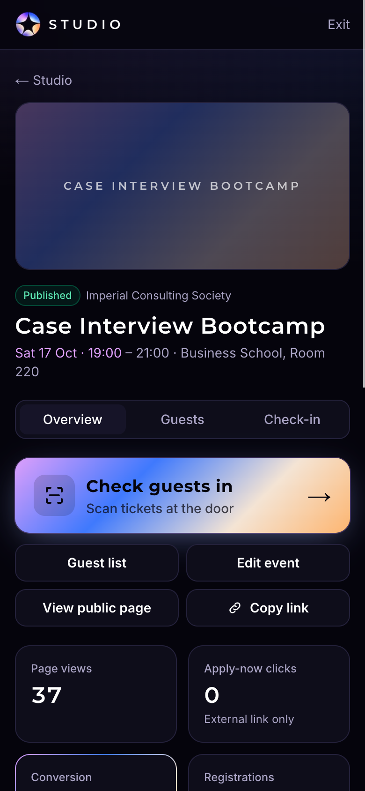
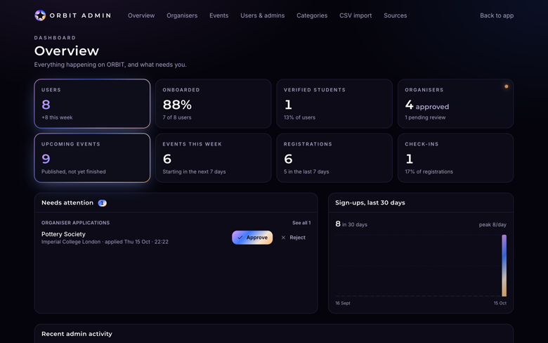

<div align="center">



### Career events, networking, socials and society nights — all in one place, ranked for you.

**[orbit.akshatgg.in](https://orbit.akshatgg.in)** · Installable on iPhone & Android · No app store needed


</div>

---

## What is ORBIT?

Students miss great opportunities because events are scattered across university portals, society
pages, careers platforms, ticketing sites and inboxes. **ORBIT brings them into one feed and ranks them
for each person** — career goals, interests, course and free time — with a clear
*"Recommended because…"* on every pick.

It's two-sided, like Luma or Eventbrite: **students** discover and register, **organisers** (societies,
university teams, employers, communities) publish and run events, and **admins** keep it trustworthy.
ORBIT launches with Imperial College Business School MSc students.

## Screenshots

<table>
  <tr>
    <td align="center"><br /><sub>Onboarding</sub></td>
    <td align="center"><br /><sub>For You feed</sub></td>
    <td align="center"><br /><sub>Event page</sub></td>
    <td align="center"><br /><sub>QR ticket</sub></td>
  </tr>
  <tr>
    <td align="center"><br /><sub>Interests</sub></td>
    <td align="center"><br /><sub>Explore & search</sub></td>
    <td align="center"><br /><sub>Organiser studio</sub></td>
    <td align="center"><sub>…and more in the app</sub></td>
  </tr>
</table>

<p align="center"><br /><sub>Admin dashboard</sub></p>

## Features

### For students
- **Personalised onboarding** — university, course, career and personal interests, formats, weekly availability.
- **For You feed** — transparent rule-based ranking with a reason on every card; hide anything with *Not interested*.
- **This Week** — top picks plus Career & academic, Social & community and Other interests.
- **Calendar** — month view of saved and registered events, with `.ics` export.
- **Explore** — full-text search with filters for date, category, career interest, format, price and location.
- **Event pages** — cover, organiser, venue & map, spots left, share, add to calendar.
- **Registration** — free tickets, paid tickets, application forms with questions, waitlists, or *Apply now* to the organiser's own site.
- **My Tickets** — scannable QR pass for every event you're going to.
- **Follow organisers**, save events, and get **push & email reminders** before events and deadlines.

### For organisers
- **Apply once** → approved by an ORBIT admin → publish freely.
- **Event studio** — 5-step editor; per event choose **free tickets**, **paid tickets** (paid straight to the organiser's own Stripe account), an **application form** with approve/decline, an **external link**, or **info only**.
- **Guest list** — approvals, search, CSV export.
- **Door check-in** — scan QR tickets with the phone camera (or type the code / search by name).
- **Stats** — views, Apply-now clicks, registrations, conversion and check-ins.
- **Public organiser page** with followers, and a team of co-organisers.

### For admins
- **Overview** with key numbers and a *Needs attention* queue.
- **Approve / reject / suspend organisers** and award the ✓ verified badge.
- **Moderate events** — feature, cancel, remove, restore; add events manually.
- **Users & admins** — the super admin adds or removes admins.
- **CSV import**, **categories**, an **audit log** of admin actions.
- **Approved event sources** — permission-checked iCal feeds, automatic refresh, duplicate detection.

### Platform
- **PWA** — installs to the home screen on iOS and Android, works full-screen, has an offline screen.
- **Security by default** — Postgres Row Level Security on every table; registrations, approvals and
  check-ins run through audited SQL functions; organisers can only see their own guests.
- **Compliance-first data** — no scraping; every event keeps its source and provenance.

## Install the app (PWA)

| Device | Steps |
|---|---|
| **Android** (Chrome) | Open [orbit.akshatgg.in](https://orbit.akshatgg.in) → **Install app** (or ⋮ → *Install app*) |
| **iPhone** (Safari) | Open [orbit.akshatgg.in](https://orbit.akshatgg.in) → **Share** → **Add to Home Screen** |
| **Desktop** (Chrome / Edge) | Click the install icon in the address bar |

Push notifications on iPhone need iOS 16.4+ and the app opened from the home screen.

## Tech stack

| Layer | Choice |
|---|---|
| App | [Next.js 16](https://nextjs.org) (App Router, Cache Components, Server Actions) · React 19 · TypeScript |
| Styling | Tailwind CSS 4 with a design system drawn from the ORBIT logo |
| Data & auth | [Supabase](https://supabase.com) — Postgres, Row Level Security, Auth (Google + email link), Storage |
| Payments | Stripe Connect (Express, destination charges) |
| Notifications | Web Push (VAPID) · [Resend](https://resend.com) email |
| Hosting | [Vercel](https://vercel.com) with daily cron jobs |
| Testing | Vitest (275 tests) · ESLint · TypeScript strict |

## Getting started

**Prerequisites:** Node.js 22+, Docker (for local Supabase).

```bash
git clone https://github.com/akshatgg/Orbit.git
cd Orbit
npm install
npm run db:start     # local Supabase in Docker: applies migrations + demo data
```

Create `.env.development.local` using the values printed by `db:start`:

```bash
NEXT_PUBLIC_SUPABASE_URL=http://127.0.0.1:54321
NEXT_PUBLIC_SUPABASE_PUBLISHABLE_KEY=<publishable key>
SUPABASE_SECRET_KEY=<secret key>
NEXT_PUBLIC_APP_URL=http://localhost:3000
NEXT_PUBLIC_DEV_LOGIN=1
```

```bash
npm run dev          # http://localhost:3000
```

`NEXT_PUBLIC_DEV_LOGIN=1` adds one-tap **Dev sign-in** buttons to `/login` (local only). Demo accounts
(password `password123`):

| Account | Email |
|---|---|
| Student (onboarded) | `student@imperial.ac.uk` |
| New user (not onboarded) | `newbie@orbit.test` |
| Organiser | `organiser@orbit.test` |
| Pending organiser | `pending@orbit.test` |
| Admin | `admin@orbit.test` |
| Super admin | `akshatg9536@gmail.com` |

### Scripts

| Command | What it does |
|---|---|
| `npm run dev` | Start the app in development |
| `npm run build` / `npm start` | Production build / serve |
| `npm test` | Run the Vitest suite |
| `npm run lint` | ESLint |
| `npm run db:start` | Start local Supabase |
| `npm run db:reset` | Rebuild the local database from migrations + seed |
| `npm run db:types` | Regenerate `src/types/supabase.ts` from the local schema |

## Environment variables

See [`.env.example`](.env.example) for the full list.

| Variable | Needed for |
|---|---|
| `NEXT_PUBLIC_SUPABASE_URL`, `NEXT_PUBLIC_SUPABASE_PUBLISHABLE_KEY` | Everything |
| `SUPABASE_SECRET_KEY` | Server jobs: payments hand-off, reminders, event sources (server only) |
| `NEXT_PUBLIC_APP_URL` | Links in emails, checkout and share previews |
| `NEXT_PUBLIC_VAPID_PUBLIC_KEY`, `VAPID_PRIVATE_KEY`, `VAPID_SUBJECT` | Push notifications (`npx web-push generate-vapid-keys`) |
| `SMTP_HOST`, `SMTP_PORT`, `SMTP_USER`, `SMTP_PASS`, `EMAIL_FROM` | Email reminders over SMTP (e.g. Gmail app password); used before Resend when set |
| `RESEND_API_KEY`, `EMAIL_FROM` | Email reminders via Resend (alternative to SMTP) |
| `CRON_SECRET` | Protects `/api/cron/*` |
| `CLOUDINARY_CLOUD_NAME`, `CLOUDINARY_API_KEY`, `CLOUDINARY_API_SECRET` | Image uploads (covers, logos) via signed Cloudinary uploads (server only); falls back to Supabase Storage when unset |
| `STRIPE_SECRET_KEY`, `STRIPE_WEBHOOK_SECRET`, `STRIPE_CONNECT_WEBHOOK_SECRET`, `PLATFORM_FEE_PERCENT` | Paid tickets |

Every optional integration degrades gracefully — without Stripe, paid tickets are switched off;
without Resend, reminders go by push only.

## Project structure

```
src/
├── app/
│   ├── (auth)/login            Sign in (Google, email link)
│   ├── onboarding/             5-step onboarding
│   ├── (main)/                 Student app with the tab bar
│   │   ├── page.tsx            For You
│   │   ├── week/ calendar/     This Week · Calendar (+ .ics export)
│   │   ├── search/             Explore
│   │   ├── tickets/            My Tickets + QR pass
│   │   └── profile/            Profile & preferences
│   ├── events/[id]/            Public event page + registration
│   ├── go/[id]/                "Apply now" redirect (click tracking)
│   ├── o/[slug]/               Public organiser page
│   ├── organiser/              Organiser studio: apply, events, guests, check-in, settings, payments
│   ├── admin/                  Admin dashboard
│   ├── checkout/               Paid-ticket confirmation
│   └── api/                    Stripe webhook · push · cron (reminders, source refresh)
├── components/                 UI kit, event cards, feature components
├── lib/                        Auth, queries, ranking, tickets, payments, notifications, sources…
└── types/                      Database types
supabase/
├── migrations/                 Schema, RLS policies and SQL functions
└── seed.sql                    Local demo data
public/sw.js                    Service worker (offline + push)
docs/                           Architecture guide, product notes, screenshots
```

Conventions, the data model and the security rules are documented in
[`docs/ARCHITECTURE.md`](docs/ARCHITECTURE.md); the product scope is in
[`docs/orbit-product-notes.md`](docs/orbit-product-notes.md).

## Deployment

1. **Supabase** — create a project (region: London), then apply the schema:
   ```bash
   npx supabase link --project-ref <project-ref>
   npx supabase db push
   ```
   In *Authentication → URL Configuration* set the Site URL to your domain and add
   `https://<your-domain>/auth/callback` to the redirect URLs. Enable the Google provider if wanted.
2. **Vercel** — import the repo, add the environment variables above, deploy. The cron jobs in
   [`vercel.json`](vercel.json) run reminders (08:00 UTC) and source refresh (03:00 UTC).
3. **Stripe** (optional) — enable Connect, add the keys, and point a webhook at
   `https://<your-domain>/api/stripe/webhook` for `checkout.session.completed`,
   `checkout.session.async_payment_succeeded` and `account.updated`.
4. **Resend** (optional) — verify your sending domain and set `RESEND_API_KEY` + `EMAIL_FROM`.

The account with the super-admin email becomes super admin automatically on first sign-in and can
appoint other admins from **Admin → Users & admins**.

## Roadmap

- Sponsored listings and organiser promotions for employers
- University partnerships and multi-university support
- Native store builds (Trusted Web Activity / Capacitor)
- Smarter, learning-based recommendations
